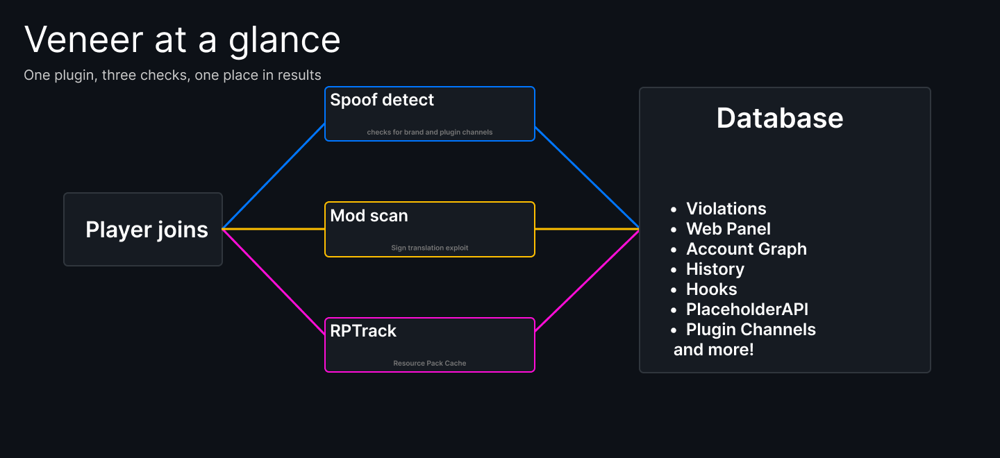

<div align="center">

# Veneer

**Catch clients that aren't what they claim to be.**

Client spoof detection, mod detection and cache-based account linking for Paper and Folia, in a single jar.


</div>

> **Status:** beta. Tested on Paper/Purpur and Folia 1.21.11 with test clients and real clients (including ViaFabricPlus and ViaProxy), not yet on a busy public server.



---

## Features

| Module | What it does |
|---|---|
| **Spoof detection** (from AntiSpoof) | Compares the client brand and registered plugin channels against what the claimed client can actually send. Catches fake `vanilla`, fake Fabric/Forge/Lunar, blocked or required channels, Geyser impersonation. Uses PacketEvents and the `minecraft:brand` channel. |
| **Mod detection** (from CheckHacks) | Finds installed mods through the sign translation vulnerability (MC-265322). Hacks are defined in config, results are stored in SQLite. Clients older than `hacks.yml detection.min-client-version` (default 1.17) are not scanned: they do not answer the probe sign. |
| **Language and version check** | `/hacklang` reads the client language, and from the same sign the client's real game version: key bindings and removed keys work in any language and tell apart every release from 1.21.5 to 26.3 (except 1.21.6-1.21.8 and 1.21.9/1.21.10), keys added in each version narrow en_us clients down to nearly the release. A version that does not match the protocol the player connects with points to ViaFabricPlus, ViaProxy and the like; an alert and an optional command follow. |
| **Web panel** | Overview counts, scan history with filters, manual scans that show up as soon as they finish, scan deletion, player pages (first and last join, client brand, channels and real version, detected mods, fingerprint, addresses, possible alts), name suggestions in search, a list of every mod detected, and a 3D graph of linked accounts (shared addresses, RPTrack fingerprints and the same client brand and channels) with player heads (drawn from the skins the server stores, no outside image host), filters by link type, strength and last seen, and search by name or IP. Each address shows its provider, AS number and country; a shared address of a VPN, Cloudflare WARP or hosting provider counts as a weaker link. The panel follows `config.yml general.language` (English and Russian). |
| **In-game GUI** | Interactive player profiles, check queues, client brand verdicts and channels overview via chest inventory or the Paper Dialog API (1.21.4+), with GrimAC violations and mouse sensitivity tracking. Run `/veneer` or `/veneer gui`. |
| **Anticheat bridge** | Flags from Grim (event bus), Vulcan, Spartan, Matrix, Intave and AAC can trigger a mod scan. A spoof flag can also queue one. |
| **RPTrack** | Links accounts and IPs of the same Minecraft installation through its resource-pack download cache, and detects LiquidBounce's local server. **Off by default.** See [RPTrack](#rptrack). |
| **Integrations** | LuckPerms (primary group), PlaceholderAPI (`%veneer_*%`), Floodgate/Geyser, Discord webhooks, Folia-aware scheduling. |

## How it works

### Spoof detection


The `minecraft:brand` string is whatever the client chooses to send. The plugin channels it registers are harder to hide, because the mods need them to work. Veneer checks the two against each other and against the rules for each known client brand in `spoof.yml client-brands`: required channels, blocked channels or a channel whitelist.

A brand that matches no rule is reported to staff with **[Allow]** and **[Block]** buttons, so staff decide whether that client is fine. The verdict is kept for that exact brand string: an allowed brand is treated as a known clean client from then on, and a blocked one is flagged, alerted and optionally punished (`spoof.yml client-brands.staff-verdicts.blocked`). `/spoof brands` lists the brands seen and lets you change or reset a verdict.

### Mod scan



Veneer sends a virtual sign packet to the client with a translation or keybind key from each mod on its lines, opens the sign editor and at once resets the virtual sign to air on the client without placing or touching any physical blocks in the server world. The editor closes and the client sends the sign text back, filled in from its own language files and key bindings. PacketEvents intercepts and cancels the update packet, so the server never processes a block change. A key no mod defines comes back as is; a key a mod defines comes back as the mod's text or bound key. The player sees, at most, a flicker. Hacks are defined in `hacks.yml detection.hacks` (`TRANSLATE`, `KEYBIND` or `METEOR` mode); a client with ExploitPreventer, which blocks the trick, shows up as `PROTECTED`.

## Install

1. Drop `veneer-<version>.jar` into `plugins/` and start the server (or `veneer-<version>-lite.jar` together with the PacketEvents plugin, see [Build](#build)).
2. Edit the files in `plugins/Veneer/`, then apply them with `/veneer reload`. Requires Paper or Folia 1.21+ on Java 21.
3. Optional: install LuckPerms, PlaceholderAPI, Floodgate/Geyser, ViaVersion or an anticheat. Veneer picks them up automatically.

## Commands

| Command | Permission | Description |
|---|---|---|
| `/veneer` | `veneer.admin` | Open the in-game GUI (player profiles, brand verdicts, check queue) |
| `/veneer player <player>` | `veneer.admin` | Inspect a player's profile in the in-game GUI (or `/veneer p`) |
| `/veneer find <player>` | `veneer.admin` | Search players and open their profile in the GUI |
| `/veneer check <player>` | `veneer.admin` | Open the mod scan launcher in the GUI |
| `/veneer brands` | `veneer.spoof.use` | Open client brand verdicts in the GUI |
| `/veneer channels` | `veneer.admin` | Open registered plugin channels overview in the GUI |
| `/veneer help` | - | The commands you may use, grouped by module; click one to put it in the chat box |
| `/veneer lang [<code>\|auto\|reset]` | `veneer.lang` (everyone) | The language Veneer's messages and alerts reach you in: a file from `messages/`, `auto` (your game language), or `reset` (the server's `config.yml general.language`). Stored per player; the console keeps the server language |
| `/veneer info <player>` | `veneer.admin` | One report per player: client brand and channels, spoof status, latest mod scan, RPTrack link |
| `/veneer alerts` | `veneer.alerts` | Toggle your own staff alerts (spoof, mod scan and RPTrack share one switch) |
| `/veneer reload` | `veneer.admin` | Reload the config files and the language files for every module |
| `/veneer version` | `veneer.admin` | Running and latest release |
| `/veneer <spoof\|hackcheck\|hacklang\|hackeditor\|rptrack> ...` | that command's | The module commands also run under `/veneer` (`scan` = `hackcheck`, `editor` = `hackeditor`), with the same permissions |
| `/spoof` | `veneer.spoof.use` | Inspect client brand and channels, re-run spoof checks (`check`, `runcheck`, `channels`, `brand`); `brands` (needs `veneer.spoof.admin`) lists unknown brands and allows or blocks them |
| `/hackcheck <player> [hacks]` | `veneer.hacks.check` | Scan a player for mods |
| `/hacklang <player>` | `veneer.hacks.lang` | Check a player's client language |
| `/hackeditor` | `veneer.hacks.editor` | Link to the web panel: scan history and manual scans |
| `/rptrack <player>` | `veneer.rptrack` | Show a player's cache fingerprint and linked accounts |

Other permissions: `veneer.spoof.admin`. Bypass (all default `false`, not in `veneer.*`): `veneer.bypass` (everything), `veneer.bypass.<spoof|hacks|rptrack>` (that module, join and later), `veneer.bypass.<type>.join` (join-time check only). The most specific bypass that is set wins, so `veneer.bypass` true with `veneer.bypass.hacks` false still scans mods, and nodes set on the player come before group ones (a player's own `veneer.bypass` beats a group's `veneer.bypass.hacks` false); `/veneer info <player>` shows the bypasses in effect and the node that grants each; `veneer.*`, `*` and other wildcards above `veneer.bypass` never grant a bypass, also with LuckPerms (read through its API when installed). Manual scans (`/hackcheck`, `/hacklang`, web panel) ignore bypasses. Wildcards: `veneer.spoof.*`, `veneer.hacks.*`, `veneer.web.*`, `veneer.*`.

Web panel rights (default op) are taken from the player when `/hackeditor` issues the token: `veneer.web.scan` (run scans), `veneer.web.delete` (delete scans), `veneer.web.links` (account graph), `veneer.web.ips` (see IP addresses; without it the graph hides them). Without any of them the token still shows the scan history.

## Configuration

One file per part, all in `plugins/Veneer/`:

```
config.yml:  # language, prefix, debug, alerts, Bedrock detection, shared Discord webhook, update checker
spoof.yml:   # brand/channel rules, punishments, Discord alerts            (enabled: true)
hacks.yml:   # hack definitions, auto-checks, anticheat hooks, web panel   (enabled: true)
rptrack.yml: # resource-pack cache tracking                                (enabled: false)
```

- An update from the old single `config.yml` splits it into these files automatically, nothing is lost.
- Settings that more than one module needs live in `config.yml` once: the Bedrock rules, the staff alert switch, the debug flag and a default Discord webhook (a module's own URL in its file wins when set).
- Settings missing from your file are added from the defaults on start and on reload, comments included. Unknown settings are reported in the console.
- Turning a module on or off needs a restart; everything else applies with `/veneer reload`.
- The mod scan messages live in `plugins/Veneer/messages/<lang>.yml` (en, ru, de, es, fr, it, br, lolcat, uwu).

## PlaceholderAPI

| Placeholder | Value |
|---|---|
| `%veneer_brand%` | Client brand |
| `%veneer_channels%`, `%veneer_channels_count%` | Registered plugin channels |
| `%veneer_is_spoofing%`, `%veneer_is_bedrock%` | `true` / `false` |
| `%veneer_client_type%` | Client type seen by the mod scan |
| `%veneer_alerts%` | `on` / `off` for the viewer |
| `%veneer_group%` | LuckPerms primary group |
| `%veneer_rptrack_packs%`, `%veneer_rptrack_linked%`, `%veneer_rptrack_liquidbounce%` | RPTrack result for the player |

## RPTrack

The Minecraft client caches downloaded resource packs by SHA-1 in `.minecraft/downloads`, shared across accounts. On join, Veneer offers 28 probe packs with a known hash and an unreachable URL; a pack answers *loaded* only if it is already cached. A fresh client is assigned a random subset of 6 packs that it really downloads, and later logins on any account or IP reproduce that subset. The technique is described in [this write-up](https://alaggydev.github.io/posts/cytooxien/).


Probe packs and a small pack that hides the "failed to download" toast must be downloadable by clients. Point `public-url` at `localhost` (e.g. `http://localhost:8123`) and Veneer serves them itself on that port, sending clients to the host they joined with. With any other URL no server is started: host `plugins/Veneer/rptrack/fp/` (exported on start) at `<public-url>/fp/`. Set it up in `rptrack`:

```yaml
enabled: true
public-url: "http://localhost:8123"   # localhost = built-in server on this port
track: 28                             # probe packs checked on every join
send: 6                               # packs a fresh client is sent (<= track)
match: 5                              # cached packs that must overlap to link accounts (<= send)
debug: false                          # log every step; also turns on the experimental unique-set mode (direct and indirect links, `match` unused)
```

> **Privacy:** this is covert tracking of players. Disclose it in your server rules or privacy policy. The ExploitPreventer mod blocks the probes, so the absence of a match proves nothing.

## Build

```
mvn -q -DskipTests clean package
```

Produces two jars (Java 21 or newer):

- `target/veneer-<version>.jar` (about 24 MB): PacketEvents bundled and relocated, nothing else to install.
- `target/veneer-<version>-lite.jar` (about 1.5 MB): runs on the [PacketEvents plugin](https://modrinth.com/plugin/packetevents), which must be installed; without it Veneer disables itself. Use it when the server already has PacketEvents or you want to update PacketEvents on its own.

## Notes

- The web panel (`/hackeditor`) listens on `127.0.0.1` by default and speaks plain HTTP, so anything beyond the same machine needs encryption: use an SSH tunnel (`ssh -L 8080:127.0.0.1:8080 host`) or a reverse proxy with HTTPS (it should pass `X-Forwarded-Proto`, so the session cookie gets the `Secure` flag). Setting `hacks.yml web-editor.bind` to a non-local address logs a warning. The link from the command works once, within `token-expire-minutes` (10): opening it binds that browser to your Minecraft account. The browser gets a random cookie secret (`HttpOnly`, `SameSite=Strict`) and the database keeps only its sha256 together with the sha256 of your nick, IP address and client (User-Agent), never the secret; the address loses the token, so nothing stays in history or proxy logs. The binding lasts `session-days` (30) and ends early if the address (`bind-ip`, on by default) or the client changes; run `/hackeditor` again then. A new link binds the new browser and unbinds the old one, so a lost device is dropped the same way. Rights are those the account had when the link was issued. An unopened link expires after `token-expire-minutes`, so don't share it. Responses are sent with `Cache-Control: no-store` and a Content-Security-Policy that runs only the page's own scripts; ten failed sign-ins in a minute from one address block it for the rest of that minute. Scan starts and deletions from the panel are logged in the server console. Join addresses and skins are kept for `hacks.yml web-editor.links.retention-days` (90) after the player was last seen, scans for `hacks.yml web-editor.history.retention-days` (180).
- The provider and country data (about 50 MB) is off by default; with `hacks.yml web-editor.links.ip-database: true` it is downloaded to `plugins/Veneer/geo/` through jsDelivr and refreshed weekly (the plugin works without it). The country is where the network is registered, not a precise location. Which providers count as weak is set by `weak-provider-asns` and `weak-provider-keywords`, the weight factor by `weak-provider-factor` (0.3). Client links need the spoof module and are recorded when a player leaves.
- To translate the panel, add `src/main/resources/web/lang/<language>.json` (English text as keys, see `ru.json`).
- Version `0.9.6` is independent of the originals (AntiSpoof 1.2.7, CheckHacks 1.3.1).
- **Folia:** every task goes through `FoliaScheduler` (global, per-entity and async schedulers; Bukkit's scheduler is no longer used anywhere), and punishments run as console commands on the global region. Tested on Folia 1.21.11 (mod scan, language check, web panel scans, death, world change and quitting mid-scan). Probe signs are purely virtual packets via PacketEvents and never touch the server world or chunks.
- Compiled against Paper API 26.1.2, `api-version: '1.21'`. Legacy 1.8.x servers are untested.

## Data, network access and privacy

What Veneer stores and what it contacts, so you can judge it before installing:

- **Stored locally** in `plugins/Veneer/data.db` (SQLite, never sent anywhere by the plugin): join addresses of players (kept `hacks.yml web-editor.links.retention-days`, 90 by default, after the player was last seen), the skin texture, the client brand and plugin channels, scan results and history (180 days by default), RPTrack cache fingerprints and the language each player picked. The web panel can delete accounts and their data.
- **Contacted by the plugin:**
  - `api.github.com`: the update check (a plain request for the latest release of `ReAndrew/veneer`, no data about your server or players; switch it off with `general.update-checker.enabled: false`).
  - `textures.minecraft.net`: the skin of a joining player is downloaded to draw its head in the panel (only that host is ever requested).
  - `cdn.jsdelivr.net`: provider and country data for addresses (about 50 MB), **off by default** (`hacks.yml web-editor.links.ip-database`).
  - A Discord webhook, only if an admin sets a URL in the config: staff alerts and scan reports go there.
- **No telemetry.** Nothing else leaves the server. The web panel listens on `127.0.0.1` unless you change `hacks.yml web-editor.bind`.
- **RPTrack** links accounts by which resource packs a client already has cached. It is off by default; enable it only if your players are told, and check that it is allowed where you run your server.
- **Mod scan** uses the sign translation vulnerability (MC-265322) to ask the client which keys it knows. It reads answers only; clients with ExploitPreventer are reported as `PROTECTED` and the scan stops. Veneer detects clients and mods; it does not hide anything from other tools.

## Credits, AI disclosure and license

Veneer began as a merge of two open-source plugins, written by their authors, and adds new modules on top:

- **[AntiSpoof](https://github.com/GigaZelensky/AntiSpoof)** by GigaZelensky (GPLv3): client brand and channel spoof detection. The detection logic in `com.veneer.spoof` comes from it.
- **[CheckHacks](https://github.com/branduzzo/CheckHacks)** by Branduzzo (MIT): mod detection through the sign vulnerability. The logic in `com.veneer.hacks` comes from it.

**AI disclosure: this project contains AI-generated code.** The merge into one plugin, the shared core, RPTrack, the version probe, the web panel (account graph, player pages, account binding), the brand verdicts, Folia support, the translations and this README were written by Claude (Anthropic) from instructions given by the repository owner, who runs and directs the work but did not write that code by hand. Treat it as AI-written code that has been tested on local Paper and Folia 1.21.11 servers with bots and a few real clients, not as audited code. The original AntiSpoof and CheckHacks code is the work of their authors; later changes to it were made with AI as well. Bug reports and reviews are welcome.

The web panel bundles [3d-force-graph](https://github.com/vasturiano/3d-force-graph) and [three.js](https://github.com/mrdoob/three.js) (both MIT, texts in `src/main/resources/web/THIRD-PARTY-LICENSES.txt`). IP provider data: [IPtoASN](https://iptoasn.com) (PDDL); country data: [geo-whois-asn-country](https://github.com/sapics/ip-location-db) (CC BY 4.0, from NRO), both via ip-location-db.

The combined work is released under **GPLv3**, see `LICENSE`; the CheckHacks MIT text is appended there for attribution.
